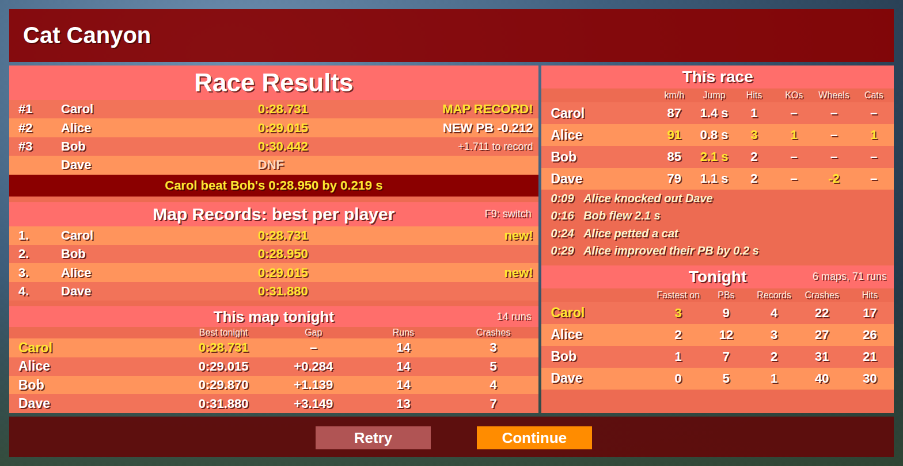
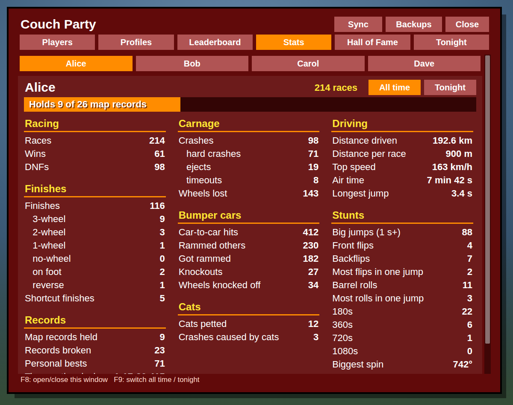
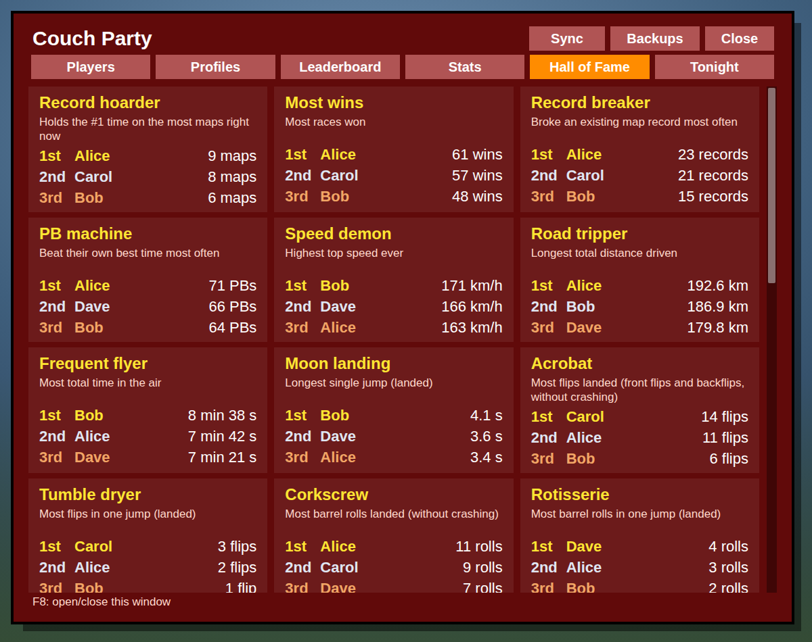

# Couch Party: a Zeepkist mod for local multiplayer

Zeepkist's local split-screen calls everyone "Player 1, Player 2…", forgets everything when you quit, and keeps no records. Couch Party fixes that, and adds a few things for bragging rights.

## What it looks like

These are mockups at 1080p with four players. In the game, the background is the game itself. Click an image for the full size.

<table>
  <tr>
    <td colspan="2" align="center">
      <a href="docs/images/results.png"></a><br>
      The results screen
    </td>
  </tr>
  <tr>
    <td align="center">
      <a href="docs/images/stats.png"></a><br>
      F8 &gt; Stats
    </td>
    <td align="center">
      <a href="docs/images/hall-of-fame.png"></a><br>
      F8 &gt; Hall of Fame
    </td>
  </tr>
</table>

## Features

**🪪 Player profiles**
- Add friends by typing a name or picking them from your Steam friends list. Profiles use the name they chose, not your nickname for them.
- Assign who is Player 1–4. Their names show on the player-select screen and in the race.
- Outfits (soapbox, hat, colour) are remembered and picked for each player automatically next time.

**🏆 Local leaderboards**
- Every local multiplayer race is saved per map. A time only counts if you pass every checkpoint, so shortcuts don't count.
- A results panel styled like the game's own screen shows **NEW PB -0.512**, **+1.234 to record**, and a banner when the record falls ("Carol beat Alice's 0:13.000 by 0.754 s").
- Two views: best time per player, or all runs, so you can see who owns the whole top 10.
- The map's top 3 pops up when a race starts, and **NEW MAP RECORD!** appears the moment someone crosses the line with a record time.

**📊 Stats and Hall of Fame**
- Lifetime stats per player:
  - **Racing:** races, wins, DNFs
  - **Finishes:** valid finishes, and of those: finishes on 3, 2, 1 or zero wheels, on foot (ejected, then crossed the line without the car) and in reverse (crossing the line backwards); plus shortcut finishes
  - **Records:** records held and broken, personal bests
  - **Carnage:** crashes (hard crashes, ejects, timeouts) and wheels lost
  - **Bumper cars:** car-to-car hits, rammed others, got rammed, knockouts (rammed someone off or into a crash) and wheels knocked off
  - **Driving:** distance driven, top speed, air time and longest jump
  - **Stunts:** big jumps, front flips, backflips and barrel rolls landed, the most flips and rolls in one jump, flat spins (180s, 360s, 720s and 1080s, plus the biggest in exact degrees)
- Switch the Stats tab between **all time** and **tonight** (a button, or F9).
- A Hall of Fame with gold, silver and bronze in every category: Crash king, Speed demon, Demolition derby, Wheel snatcher, Moon landing, Acrobat, Spin doctor, Moonwalker, No-wheel hero, Stuntman and more.

**🛠️ Under the hood**
- A C# BepInEx plugin built on ZeepSDK, with Harmony patches into the game.
- Everything is stored locally, with nothing online.
- Press **F8** for the menu, which is styled to match the game.

## Install

Requires **ZeepSDK** (Modkist installs it together with BepInEx).

1. Copy `CouchParty.dll` into `<Zeepkist folder>\BepInEx\plugins\`.
   The Zeepkist folder is usually `C:\Program Files (x86)\Steam\steamapps\common\Zeepkist`.
   (In Steam: right-click Zeepkist > Manage > Browse local files.)
2. Start the game.

## How to use

| Key | What it does |
|---|---|
| **F8** | Open/close the Couch Party window |
| **F9** | Switch view: on the Stats tab between **all time** and **tonight**; on the results screen between **best per player** and **all runs** |

1. **Profiles tab:** add your friends by typing a name (Enter adds it) or choosing from Steam friends. Steam profiles use the name your friend chose, not the nickname you gave them. To rename, press **Rename**, type, then press **Enter** (Esc cancels).
2. Go to the player-select screen and let everyone join as usual.
3. **Players tab:** choose a profile for Player 1, 2, 3 and 4. The game now shows those names instead of "Player N". Your picks are remembered for next time.
4. **Outfits are automatic.** Whatever a player picks on the player-select screen is saved to their profile when the race starts. Next time that player joins, their saved outfit is selected for them; they can still change it, and the new choice is saved instead.
5. Race. When the results screen opens, the mod's panel covers the game's "Race Results" column with this race's times and the map's top 10. Each line is tagged: **MAP RECORD!** (plus a banner saying whose record was beaten and by how much), **NEW PB -0.512** (how much you improved), or **+1.234 to record** (the gap to the record). The map's top 10 shows **best per player** by default. Press **F9** (or click the header) to switch to **all runs**, where one player can appear several times.

   The results screen is split into two sides:
   - **Left, this map:** the race results (with PB / record tags and a banner when the record falls), the map's records (as many as fit; F9 switches between best per player and all runs) and **This map tonight**: each player's best time tonight on this map, the gap to the fastest, runs and crashes.
   - **Right, this race and the evening** (over the game's Championship points): **This race** with each player's top speed, longest jump, car-to-car hits, knockouts, wheels lost and cats (best in gold) plus up to 5 **moments** in the order they happened ("0:12 Alice knocked out Bob", "0:24 Photo finish! ..."), and **Tonight**: the evening's standings. **Fastest on** counts on how many of tonight's maps you have the fastest time of the evening, next to PBs, records, crashes and hits.

   A new evening starts after 6 hours without racing (`New evening after hours` in the config); restarting the game in between doesn't reset it.
6. **Leaderboard tab:** every map, with the same "Best per player" / "All runs" switch. **x** removes one time (or all of a player's times in the per-player view).
7. **Stats tab:** pick a player to see their stats in groups. The headline is how many maps they hold the #1 time on ("Holds 5 of 8 map records"). Click **Tonight** (or press **F9**) to see only this evening's stats. Tonight counts the same evening as the Tonight tab: this PC only, and it starts over after 6 hours without racing. In tonight's view the headline is on how many of tonight's maps the player has the fastest time ("Fastest on 2 of 6 maps tonight"), and **Map records held** becomes **Fastest on (maps)**. Click **All time** (or press **F9** again) to go back.
8. **Tonight tab:** the evening's standings and **every map played tonight** (newest first) with who's fastest on it, plus a **Start a new evening** button.
9. **Hall of Fame tab:** the top 3 (gold, silver, bronze) in each category: records held (Record hoarder), wins, records broken, PBs, top speed, distance, air time (Frequent flyer), longest jump (Moon landing), flips landed (Acrobat), barrel rolls landed (Corkscrew), most flips in one jump (Tumble dryer), most barrel rolls in one jump (Rotisserie), biggest spin in exact degrees (Spin doctor), reverse finishes (Moonwalker), hard crashes (Crash king), ejects (Ejector seat), timeouts (Snail), wheels lost, finishes missing wheels, no-wheel finishes, on foot finishes (Stuntman), shortcut finishes, rammed others (Bumper car champ), knockouts (Demolition derby), wheels knocked off (Wheel snatcher), got rammed (Punching bag), cats petted (Cat lover), crashes caused by cats (Cat's revenge).

Stats tracked: lifetime stats per profile (races, wins, finishes, DNFs, shortcut finishes, personal bests, map records broken and held, crashes (including ejects and timeouts), wheels lost, finishes on 3 / 2 / 1 / 0 wheels, on foot finishes (ejected, then crossed the line without the car), car-to-car hits, rammed others, got rammed, knockouts (you rammed someone and they crashed soon after), wheels knocked off (you rammed someone and they lost a wheel before recovering), cats petted (walking cats hit by your car), crashes caused by cats, distance driven, top speed, air time (total, longest jump), stunts (big jumps of 1 s+, front flips, backflips and barrel rolls landed, most flips and most rolls in one jump, 180s / 360s / 720s / 1080s landed, biggest spin in exact degrees), reverse finishes, total time on the clock).

Leaderboard entries are linked to the profile, not the name, so renaming a profile renames all their old records too.

## How the stats are counted

All stats come from local multiplayer races and only for players with a profile.

**Race results**
- **Finish:** crossing the line with every checkpoint. Only these times go on the leaderboard.
- **Shortcut finish:** crossing the line with a checkpoint missed. Counted in your stats, but the time isn't saved to the leaderboard.
- **DNF:** not crossing the line at all.
- **Win:** the fastest valid finish in a race with 2 or more players.
- **On foot finish:** a valid finish where you had already ejected (pressed Y) and your character, thrown out like a rag doll, tumbled over the line without the car.
- **3, 2, 1 and no-wheel finishes:** a valid finish, driving over the line with that many wheels still on the car. Not counted for on foot finishes.
- **Reverse finish:** a valid finish where the car crosses the line rear wheels first, moving at least 120° off the direction the car is facing. Not counted for on foot finishes.

**Crashes and wheels**
- **Crash:** your race ends before the finish line. That's a hard crash (you hit something or landed badly), an eject (you pressed Y), or a timeout (you were too slow for 10 seconds and the game ejected you). All three count as a crash, for knockouts and for "crashes caused by cats" too. The Stats tab also shows how many were hard crashes, ejects and timeouts. Ejects are recognised from how the game ends your race; if one is ever labelled wrong, it still counts as a crash.
- **Wheels lost:** each wheel that breaks off before you finish.

**Bumper cars**
- **Car-to-car hit:** while both of you are still racing, your car (body or wheels) hits another racer's car or character at an impact of at least about 11 km/h. Both players get one. The same two players can only score one hit per second, so a long scrape counts once.
- **Rammed others / got rammed:** in every car-to-car hit, whoever was moving towards the other car faster just before the hit "rammed others"; the other "got rammed". In a rear-end hit, the car behind is the rammer. So car-to-car hits = rammed others + got rammed.

**Knockouts**

Every car-to-car hit has a rammer: whoever was moving towards the other car faster. The player who got rammed is "marked" for a short while, with the rammer as the culprit (a new hit replaces the culprit). If a marked player **crashes** (including ejects and timeouts), the rammer gets a **knockout**.

Light bumps count too (anything from about 11 km/h of impact). Two cars rubbing against each other while fighting for a turn, and one of them crashing because of it, is a knockout.

How long the mark lasts:
- **Staying on the wheels** (a pit manoeuvre, a shove): **3 seconds**. A crash within 3 seconds of the hit counts.
- **Knocked into the air:** until they've been back on the track for a full second. A crash at the end of a long jump still counts. Landing on the map's flat ground below the track doesn't count as back, because from there you usually can't get back to the track. If you do drive back onto it, the mark clears after a second there as usual.
- **Never longer than 15 seconds.** Someone pushed off the map who doesn't crash within 15 seconds doesn't count. Not finishing the race is never a knockout on its own: in Zeepkist, one crash and you're out, and that's usually your own doing.
- **Crossing the finish line** clears the mark.
- **Reaching the finish anyway:** if they eject while marked (say, after landing on the map's flat ground) and still cross the finish line on foot, it's not a knockout. The eject still counts as their crash.

Only the rammer can get a knockout. If you ram someone and *you* end up crashing, it's just your own crash: the other player gets nothing for it.

- **Wheels knocked off:** uses the same mark as knockouts. Every wheel the rammed player loses while still marked counts for the rammer, whether it breaks off in the hit itself or when they're shoved into a wall or land badly afterwards. Losing a wheel while ramming someone else is just your own lost wheel.

**Cats**
- **Cat petted:** while you're still racing, your car hits one of the walking cats at about 4 km/h or more. Each cat counts once per 2 seconds.
- **Crash caused by a cat:** you crash (including ejects and timeouts) soon after hitting a cat, using the same timing as knockouts: within 3 seconds if you stay on your wheels, longer if the cat sent you flying (up to 15 seconds).

**Driving**
- **Distance:** how far your car moves while racing (not after crashing or finishing).
- **Top speed:** your car's highest speed in km/h, measured only while on the track (a wheel or the car body touching it) and not in the first second after landing. Falling off a cliff, or landing on the map's flat ground below the track, doesn't count.
- **Air time:** time with no wheel and no part of the car touching anything. Hops under 0.3 seconds don't count. Air time counts every jump, even one that ends in a crash.
- **Longest jump:** your longest single jump, but only one you landed like a stunt (see below): on the track, with no crash within 3 seconds.

**Stunts**

During each jump, the mod adds up how far the car turns around its own three axes:
- **Front flip / backflip:** nose over tail, forwards or backwards. Every full turn counts, so turning twice is a double backflip.
- **Barrel roll:** rolling sideways around the car's length.
- **Spin:** turning flat, like a snowboard trick. Counted in half turns: 180, 360, 540, 720, 900 and 1080. Anything bigger is a "1080+".

Only turning in the air counts. Riding all the way round inside a tube or a loop, with the wheels on the track, is not a barrel roll or a flip. If the car leaves the wall for a moment, only the turning during that moment counts, and that's far too little for a trick.

Nobody lands at exactly 360°, so a flip or roll counts from 300° and a spin from 45° short of the half turn (135° is a 180, 315° is a 360). One jump can have several tricks, like "a backflip + 360".

**A stunt only counts if you land it on the track:** the jump has to end on the real track, not on the map's flat ground below it (falling off the map can end in silly 10x spins), and no crash (including ejects and timeouts) within **3 seconds** of touching down. Crossing the finish line mid-air counts as landing it. Stunts show up as moments on the results screen.

- **Big jumps:** 1 second or more in the air, landed like a stunt.
- **Flips and barrel rolls:** every full turn adds one, so a double backflip adds 2 to Backflips. **Most flips in one jump** and **most rolls in one jump** keep your best single jump: a triple barrel roll is 3.
- **Spin counters:** 180s, 360s, 720s and 1080s. The in-between sizes go with the one below: a 540 counts as a 360, a 900 as a 720, and anything from 1080 up as a 1080. **Biggest spin** is your best one in exact degrees (like 2245°), and that's what the Spin doctor in the Hall of Fame ranks.

The mod finds out which way each car model faces at the start of every race, as soon as the car rolls straight at 20 km/h or more. Until then, nothing counts.

## Sync between PCs

Use the same profiles, stats and leaderboards on several PCs, for example at a friend's place, through your own small server. See [server/README.md](server/README.md) for setting it up (Docker plus a reverse proxy with HTTPS).

- **Setup:** each PC needs its own key. Create one on the server (the name is just a label for that PC):

  ```bash
  docker compose exec couchparty python /app/server.py addkey friends-pc
  ```

  Then, in the game on that PC, open **F8 → Sync**, enter your server address and the key, and press **Save & sync**. See [Managing keys](server/README.md#managing-keys) for listing, removing and replacing keys.
- **Offline:** every PC keeps a full copy and works offline.
- **When it syncs:** when the game starts, a few seconds after each race or profile change, and with **Sync now**.
- **Merging, so nothing is lost:**
  - All runs from every PC are combined. Times you removed and maps you cleared stay removed.
  - Stats are counted per PC and added together.
  - Renames and deletions: the newest change wins.
- **What stays per PC:** Player 1–4 picks and outfits, since cosmetic unlocks differ between Steam accounts.
- **Keep every PC on the same mod version.** An older version doesn't know newer stats and would drop them when uploading. So if a PC finds data from a newer version on the server, it only downloads (you still see the latest profiles and times) and shows "update the mod on this PC" until it's updated.
- **Leaving a friend's PC:** press **Forget on this PC** to stop it syncing. You can also remove that PC's key on the server.
- **Where settings live:** the server address and key are stored in `BepInEx\config\com.skofdo.couchparty.cfg` on each PC, never in the mod or this repository.

## Backups

Your profiles, stats and leaderboards are backed up automatically. Open **F8 → Backups** to see them.

- **When:** a backup is made when you start the game, but only if something changed since the last one.
- **How many:** the newest 30 are kept. The limit is a count, not an age, so months without playing never delete anything. Backups made before a mod update are kept forever.
- **Restore:** press **Restore** next to a backup. Your current data is backed up first, so a restore can be undone.
- **Backup now** and **Open backup folder** are on the same page.
- **Unreadable files:** if a data file can't be read, the mod sets it aside as `*.unreadable-<date>.json` instead of overwriting it, and warns you in the game.
- **Extra copy:** set `Extra backup folder` in the config (e.g. a OneDrive folder) to keep a second copy of every backup.

**Start fresh** (F8 → Backups → Start fresh…) wipes stats and leaderboards, or everything including profiles, on every synced PC. A PC that was offline at the time drops its old data the next time it syncs, instead of uploading it again. A backup that's kept forever is made first. You confirm by typing `WIPE`. Old versions in the server's `data/history/` folder stay until you delete them there.

**Deleting a profile** moves it to an archive. If you add the same player again later (the same Steam friend, or the same name for typed profiles), their records and stats come back.

Notes:
- Only **local multiplayer** races (2+ players, not online) are recorded.
- Only players **with a profile** get their times saved.
- A time only counts if the player passed **every checkpoint** (shortcuts show as "missed checkpoint" and aren't saved).
- Races are always recorded.
- When a race starts, the map's top 3 always shows for a few seconds. When someone beats the map record, a "NEW MAP RECORD!" popup appears.
- While the mouse is over the Couch Party window (or you're typing in it), the game ignores clicks and key presses, for everyone, including controllers.
- Remove a single time with the **x** next to it in the Leaderboard tab.
- Outfits can only use cosmetics that the Steam account running the game has unlocked.
- Saved data lives in `%AppData%\Zeepkist\Mods\com.skofdo.couchparty\` (`profiles.json`, `leaderboard.json`).
- Key bindings and options are in `BepInEx\config\com.skofdo.couchparty.cfg`.

## Testing checklist

Send `BepInEx\LogOutput.log` afterwards. The mod writes `[debug]` lines into it.

- [ ] The log says `Couch Party 1.0.6 loaded`.
- [ ] The top-3 popup appears for a few seconds when a race starts, then fades. It doesn't appear on the player-select screen.
- [ ] F8 > Stats: **Tonight** (or F9) shows only tonight's races; **All time** (or F9 again) goes back. After a race, both views went up by the same amount.
- [ ] Beating the map record shows "NEW MAP RECORD!" right after crossing the finish (or at the latest on the results screen).
- [ ] With the F8 window open, clicking inside it no longer clicks game buttons behind it.
- [ ] The log has `Scene: '...'` lines. Send them if popups never appear.
- [ ] Crossing the finish logs `Player N crossed the finish: X wheel(s) on` (plus `ON FOOT` after ejecting). Dying without finishing logs nothing.
- [ ] After a race, the Stats tab shows races, crashes, distance and top speed. The log has `Stats: PlayersReady[...] -> Player N` lines; check they match who was who.
- [ ] Big jumps log `Stunt landed! Player N: big jump (1.4 s in the air; ...)`; the Stats tab shows air time and longest jump under Driving, big jumps under Stunts.
- [ ] Knockouts log `Knockout! Player X took out Player Y (...)`, and wheels knocked off log `Wheel knocked off! ...`.
- [ ] F8 → Backups lists a backup after starting the game; Restore works and the "before restore" backup appears.
- [ ] Deleting and re-adding a player shows "Welcome back ... Restored their records and stats".
- [ ] F8 → Sync: after Save & sync it says "Uploaded (first sync)" or "Synced"; a second PC sees the same profiles and times.
- [ ] Top speed looks about right compared to the in-game speedometer.
- [ ] Each race logs `car axes: up ..., forward ...` for every player.
- [ ] A front flip logs `rotated in the air ... flip +...°`, a backflip `flip -...°`, and landed ones log `Stunt landed! ...`.
- [ ] Every finish logs the angle off the car's nose; crossing the line backwards says `BACKWARDS!` and counts a reverse finish.
- [ ] Crashes and lost wheels after a ram log `Last rammed by Player N X s ago (...)`.
- [ ] Every jump logs `jump: X s, Y m far, ...` (to decide what a big jump is).

If times end up next to the wrong players, set `Player number base` in the config file to `0` or `1` (default `-1` = automatic) and tell me which one worked.

## Building from source

Needs the .NET SDK (6 or newer).

```bash
dotnet build -c Release
```

By default the build looks for BepInEx in `C:\Program Files (x86)\Steam\steamapps\common\Zeepkist\BepInEx\core`. If your game is elsewhere, pass the path:

```bash
dotnet build -c Release -p:BepInExCoreDir="D:\SteamLibrary\steamapps\common\Zeepkist\BepInEx\core"
```

The output is `bin\Release\CouchParty.dll`.

**Tests:** `tests/` has automated checks for the sync merging, old save files, Start fresh and the version guard. After building, run `dotnet run --project tests/CouchParty.Tests -c Release`. See [tests/README.md](tests/README.md).
